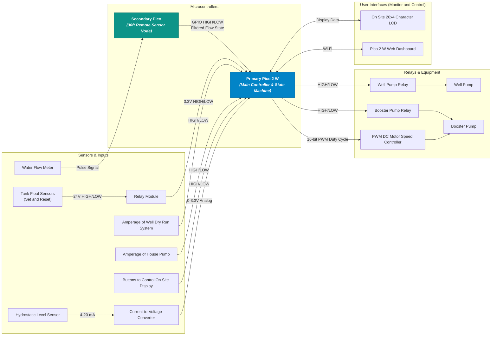

# Robust Well Control

**Custom automated dual-pump control and monitoring system built on Raspberry Pi Pico 2 W.**

---

### System Purpose & Core Objectives

This system automates water transfer from a low-yield well into a residential storage tank for household use. It coordinates two pumps, prevents dry-run pump damage, and tracks well recovery and water usage performance over time.

* **Dual-Pump Automation:** Controls both the well pump and booster pump while enforcing safety cut-offs to prevent the well pump from running dry.
* **Tank Level Management:** Tracks tank capacity in real time to keep household water at maximum capacity without overfilling or cycling pumps unnecessarily.
* **Onsite & Remote Interfaces:** Features a local 20x4 character LCD display for immediate status checks alongside a lightweight web dashboard hosted on the Pico 2 W for remote monitoring.
* **Data & Trend Logging:** A lightweight web page hosted on the Pico displays fill and usage patterns, storing data in space-efficient format of .bin for maximum longevity.

