# Robust Well Control

**Custom automated dual-pump control and monitoring system built on Raspberry Pi Pico 2 W.**

---

### System Purpose & Core Objectives

This system automates water transfer from a low-yield well into a residential storage tank for household use. It coordinates two pumps, prevents dry-run pump damage, and tracks well recovery and water usage performance over time.

* **Dual-Pump Automation:** Controls both the well pump and booster pump while enforcing safety cut-offs to prevent the well pump from running dry.
* **Tank Level Management:** Tracks tank capacity in real time to keep household water at maximum capacity without overfilling or cycling pumps unnecessarily.
* **Onsite & Remote Interfaces:** Features a local 20x4 character LCD display for immediate status checks alongside a lightweight web dashboard hosted on the Pico 2 W for remote monitoring.
* **Data & Trend Logging:** A lightweight web page hosted on the Pico displays fill and usage patterns, storing data in space-efficient format of .bin for maximum longevity.

### System Architecture

### Key Features & Safety Logic

The core firmware operates as a deterministic finite state machine (FSM), built to prevent rapid pump cycling, eliminate dry-run damage, and maintain continuous operational visibility.

#### Hardware Safety & Dry-Run Protection
* **Dry-well Protection** The secondary Pico reads flow data from the well line, filtering out noise and potential outlier readings to determine true stagnation of flow. Amperage reading of well pump determines if the well has suddenly run dry due less resistance from no water flow. Using both systems, all dry-well events are caught and power cuts to well pump and booster pump to prevent damage.
* **Recovery Time:** An adjustable lockout period is started after a dry-well event, allowing the aquifer time to recover before attempting a fill cycle.
* **Grace Period:** Upon startup, allows a short grace period before monitoring for the dry-well state, allowing pumps to startup and for the flow and amperage readings to set up a baseline.
* **Set/Reset Sensors:** Uses two level sensors in the tank in a Set/Reset configuration to prevent rapid cycling of the well every time water falls below the max sensor.\

#### Displays & Optimized Storage
* **On-Site Display:** A 20x4 LCD display and four buttons are located next to the pumps and electronics to provide immediate feedback on the level of the tank, the state of the pumps, daily average trends of fill and tank readings, and manual controls for the pumps, pump speed, and dry-well recovery duration.
* **Web Dashboard:** Locally hosted web page on the Pico 2 W, containing a real-time graph of the well water level readings, a full spreadsheet of all daily recorded data, and settings to control the pumps, similar to the on-site display.
* **Long-term Data Retention:** Packs daily timestamped min/max tank readings, fill amount, daily usage, and pump runtimes into a custom binary structure to minimize flash wear and maximize data on the limited 4 MB of memory on the Pico 2 W.
* **Short-term Data Retention:** Displays a real-time graph of recorded water level readings, up to a week ago, along with options for a higher density graph of 3 days and 24 hours ago, in a custom binary structure to maximize data displayed on the web dashboard given the limited 520 KB of SRAM.
* **Scheduled Restarts:** Every five days the Pico checks to make sure it's in a dormant state (when the well isn't actively pumping) and restarts to clear and avoid any memory fragmentation, especially given memory-intensive Web Dashboard hosted by the Pico.
